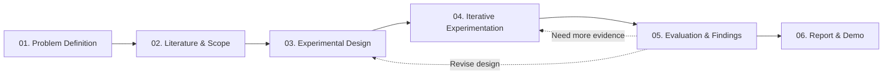

# IE105 · Project Hub

> **Course:** IE105 - Nhập môn Bảo đảm và An ninh Thông tin  
> **Topic:** Backdoor Attack trong mô hình học máy
> **Current Status:** 01. Problem Definition

Repository này là **Project Hub** của nhóm trong đồ án IE105, dùng để quản lý tài liệu, nghiên cứu, thí nghiệm và theo dõi tiến độ của đề tài.

##  Project Overview

Đề tài tập trung tìm hiểu **Backdoor Attack** trong Machine Learning / Deep Learning, trước mắt trên bài toán **phân loại hình ảnh**.

Mục tiêu là hiểu:

- Backdoor Attack hoạt động như thế nào.
- Trigger và dữ liệu poison ảnh hưởng đến mô hình ra sao.
- Mức độ thành công của tấn công.
- Ảnh hưởng đến độ chính xác trên dữ liệu sạch.
- Một số phương pháp phát hiện hoặc phòng thủ Backdoor.

## Scope

**Initial Baseline:**

- Image Classification
- Deep Learning
- Backdoor / Data Poisoning Attack
- Một số phương pháp Defense
- Đánh giá và so sánh kết quả thực nghiệm

## Repo Structure

```text
project-hub/
├── README.md
├── docs/           # Tài liệu dự án
├── experiments/    # Thiết kế và kết quả thí nghiệm
├── src/            # Source code
└── results/        # Metrics, biểu đồ và kết quả đánh giá
```

## Project Stages



## Documentation

Các quyết định, phạm vi nghiên cứu, thiết kế thí nghiệm và kết quả quan trọng sẽ được lưu trong repository để làm **nguồn tham chiếu chính thức của dự án**.

